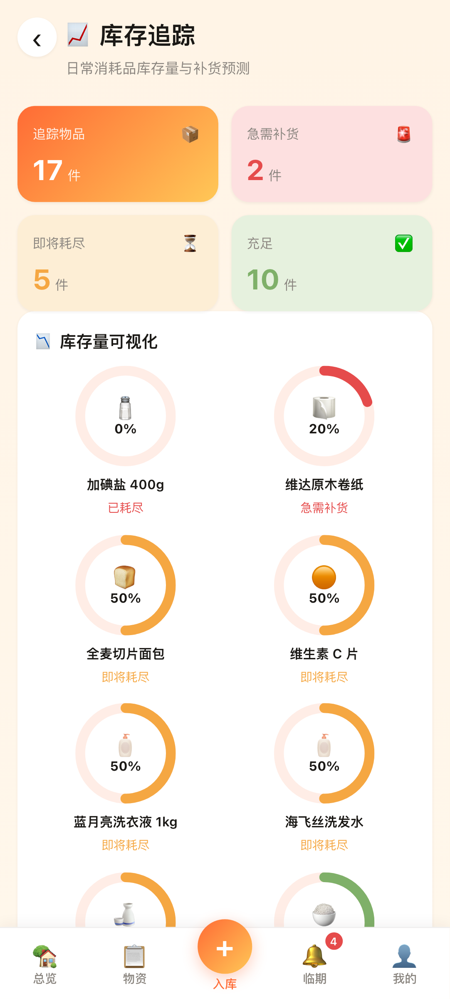
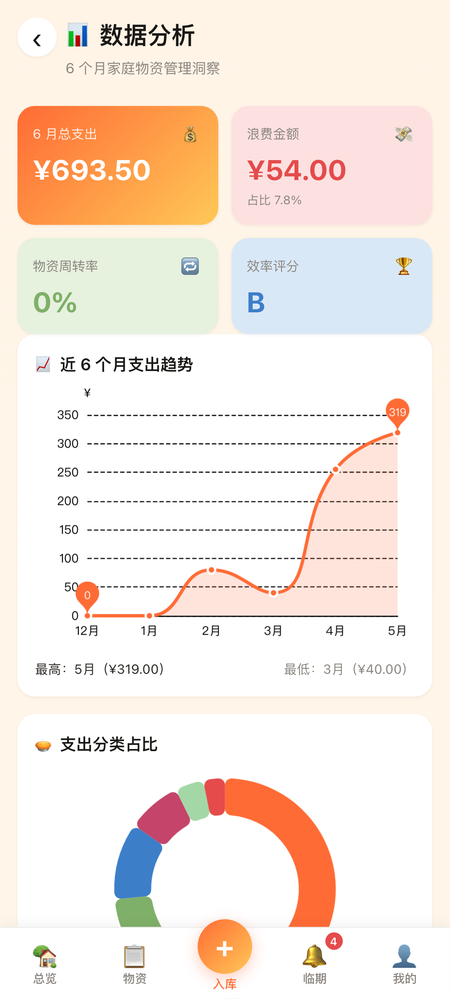

# 悦家库存 HomeStock v1.0

> 家庭物资效期与库存管理系统 · Vue 3 + Capacitor 6 + IndexedDB · 全本地存储，零数据采集

[](LICENSE)
[](https://vuejs.org)
[](https://vitejs.dev)
[](https://capacitorjs.com)

---

## 🏡 项目简介

**悦家库存（HomeStock）** 是一款专为中国家庭设计的物资管理应用：
- 食品 / 药品效期登记与临期预警
- 日用品库存追踪与智能补货
- 多达 12 个家庭存放位置管理
- 智能购物清单 + 商超分组
- 6 个月家庭支出趋势分析
- **完全本地化** — 所有数据保存在浏览器 IndexedDB，零网络请求，零数据采集

著作权人：**柴琳** · 开源协议：**MIT**

## 📱 截图

| 库存总览 | 物资清单 | 库存追踪 | 数据分析 |
|---|---|---|---|
|  |  |  |  |

完整截图见 `docs/screenshots/`。

## 🚀 快速开始

### 环境要求
- Node.js 18+
- npm 9+
- (Android 构建) JDK 17+ 与 Android SDK 35

### 开发

```bash
npm install
npm run dev              # Vite 开发服务器 → http://localhost:5173
```

### 测试

```bash
npm test                 # Vitest 运行所有 81 个测试
npm run test:cov         # 含覆盖率报告
```

### 构建

```bash
npm run build            # 输出 dist/ 静态资源
npm run preview          # 预览生产构建
```

### Android 打包

```bash
npm run android:build:debug      # 构建 debug APK（用于真机测试）
npm run android:build:release    # 构建 release AAB（用于 Play Store）
npm run android:open             # 在 Android Studio 中打开
```

## 📂 项目结构

```
homestock/
├── src/
│   ├── main.js                  # 引导入口
│   ├── App.vue                  # 根组件
│   ├── router.js                # Vue Router + 路由守卫
│   ├── views/                   # 12 个页面（Dashboard, Items, AddItem, ...）
│   ├── components/              # 共享 UI 组件 + 图表
│   ├── stores/                  # Pinia 状态管理（6 stores）
│   ├── services/                # IndexedDB / 算法服务
│   ├── constants/               # 类别 / 位置 / 阈值常量
│   ├── utils/                   # 格式化 / Toast / 演示数据
│   └── styles/                  # 3 主题 + 工具样式
├── android/                     # Capacitor 生成的 Android 工程
├── tests/                       # Vitest 单元 / 集成测试
├── docs/
│   ├── PRIVACY_POLICY.md        # 隐私政策（中英双语）
│   ├── PLAY_STORE_LISTING.md    # Play Store 上架文案
│   ├── UPLOAD_GUIDE.md          # 完整上架指南
│   ├── screenshots/             # 8 张 Play Store 手机截图
│   ├── store-graphics/          # 应用图标 + 特性图
│   └── superpowers/             # 设计文档 + 实现计划
├── assets/                      # 图标 / 启动图 SVG 源
├── capacitor.config.json
├── keystore.properties.template # 签名配置模板
└── vite.config.js
```

## 🧰 技术栈

| 层 | 选型 |
|---|---|
| 框架 | Vue 3.4 (Composition API + `<script setup>`) |
| 构建 | Vite 5 |
| 路由 | Vue Router 4 (`createWebHashHistory`) |
| 状态 | Pinia 2 |
| 数据 | IndexedDB via `idb` 8 |
| 图表 | ECharts 5 (按需引入) |
| 日期 | dayjs 1.11 |
| 样式 | 原生 CSS + CSS Variables (3 主题) |
| Android | Capacitor 6 + Android Gradle 8 |
| 测试 | Vitest + fake-indexeddb |
| Lint | ESLint 9 (flat) + Prettier 3 |

## 🔑 数据模型

IndexedDB `HomeStockDB` v1 含 6 个对象存储：

| Store | 说明 |
|---|---|
| `items` | 物品主表（19 字段，含 5 个索引） |
| `categories` | 8 个预置类别（食品/药品/日用品/...） |
| `locations` | 12 个预置存放位置 |
| `consumptions` | 消耗记录（含时段、数量） |
| `shoppingList` | 购物清单（含自动 / 手动来源） |
| `settings` | 应用设置（主题、通知、阈值） |

## 🧠 智能算法

- **临期判定** (`src/services/dateService.js`): 5 级分类（紧急 ≤2 天 / 临期 3-7 天 / 关注 8-30 天 / 新鲜 >30 天 / 已过期）
- **库存预测** (`src/services/algorithmService.js`): 取近 30 天消耗记录求日均，预测耗尽天数
- **自动补货**: 在购物清单页点「同步自动补货」后，`daysToEmpty < 7` 或 `currentQty <= minStock` 时写入购物清单。建议去处是四个固定店名，不是联网查询
- **浪费分析**: 启发式分类（遗忘 / 购买过多 / 口味变化）

## 🎨 主题系统

3 套主题通过 `<html data-theme="...">` 切换，所有颜色用 CSS Variables：
- **家居暖色** (默认): 陶土橙 + 暖黄 + 嫩绿
- **深色模式**: 暗色背景 + 橙色强调
- **清新自然**: 嫩绿主调

## 🔒 隐私设计

- 仅 `INTERNET` 权限（用于 WebView 加载本地资源，运行时无网络请求）
- `allowBackup="false"`、`usesCleartextTraffic="false"`
- 自定义 `dataExtractionRules` 排除云备份与设备迁移
- 用户数据通过应用内"导出 JSON"手动备份

线上政策页：<https://lin-chai49.github.io/homestock-privacy/>。仓库里的 [docs/PRIVACY_POLICY.md](docs/PRIVACY_POLICY.md) 只指向这一页。

## 📜 Scripts

| 命令 | 用途 |
|---|---|
| `npm run dev` | 开发服务器（Vite，端口 5173） |
| `npm run build` | 生产构建 |
| `npm run preview` | 预览生产构建 |
| `npm test` | 运行测试一次 |
| `npm run test:watch` | 监视模式 |
| `npm run test:cov` | 含覆盖率 |
| `npm run lint` | ESLint 检查 |
| `npm run lint:fix` | 自动修复 |
| `npm run format` | Prettier 格式化 |
| `npm run format:check` | 检查格式 |
| `npm run android:sync` | 构建 + 同步到 Android |
| `npm run android:open` | 在 Android Studio 打开 |
| `npm run android:build:debug` | 构建 debug APK |
| `npm run android:build:release` | 构建 release AAB |

## 📤 上架 Play Store

完整指南见 [docs/UPLOAD_GUIDE.md](docs/UPLOAD_GUIDE.md)。简要步骤：

1. 注册 Google Play Console 账号（$25）
2. 生成签名 keystore：`keytool -genkeypair ...`（见上架指南）
3. 配置 `keystore.properties`
4. 隐私政策 URL 使用已发布的 <https://lin-chai49.github.io/homestock-privacy/>
5. 构建 release AAB：`npm run android:build:release`
6. 上传到 Play Console，提交审核

## 🏗️ 设计文档

- 设计规格：[docs/superpowers/specs/2026-05-13-homestock-design.md](docs/superpowers/specs/2026-05-13-homestock-design.md)
- 实现计划：[docs/superpowers/plans/2026-05-13-homestock-implementation.md](docs/superpowers/plans/2026-05-13-homestock-implementation.md)

## 🗺️ 后续版本

- **v1.1**: 扫码入库（@capacitor-mlkit/barcode-scanning）、备份加密、英文 i18n
- **v1.2**: 物品照片、本地通知提醒
- **v2.0**: 可选 WebDAV 同步、家庭成员共享（端到端加密）

## 📄 License

MIT © 2026 柴琳
