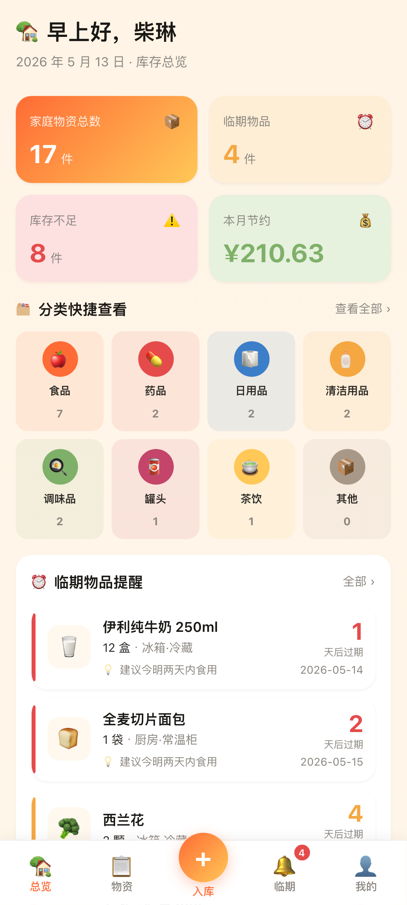
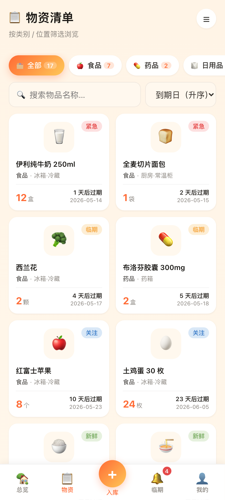
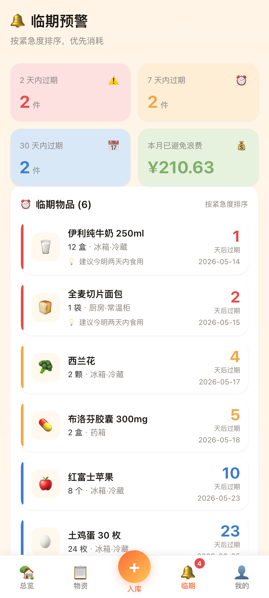
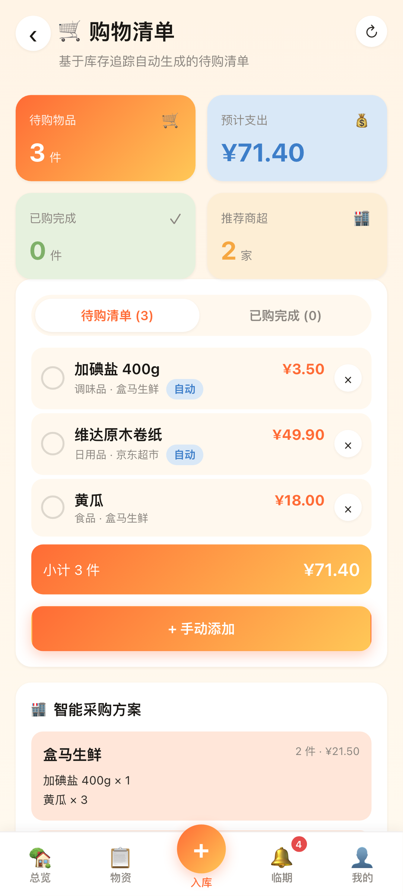

# 悦家库存 HomeStock

Android 应用，用来记家里还有什么、放在哪、哪天到期。包名 `com.chailin.homestock`，版本 1.0.0（versionCode 2）。

没有账号。你输入的名称、数量、到期日、昵称和住址写在这台手机的 IndexedDB 数据库 `HomeStockDB` 里。应用不会把这些记录上传。清单里有 `android.permission.INTERNET`，只为了让 WebView 打开随包页面。

著作权人柴琳。协议 [MIT](LICENSE)。隐私政策在 <https://lin-chai49.github.io/homestock-privacy/>。

| 库存总览 | 物资清单 | 临期预警 | 购物清单 |
|---|---|---|---|
|  |  |  |  |

其余截图在 `docs/screenshots/`。

## 1.0.0 里有什么

第一次打开要填 2 到 20 个字的昵称，存在本机。然后可以：

- 登记一件物品：名称、类别、品牌、规格、数量、单位、最低库存、购买日、到期日、金额、备注、存放位置。金额只出现在本机图表里，不是付款。
- 用掉一件东西，并记下场景。场景是七个固定标签：早餐、上午、午餐、下午、晚餐、睡前、日常。
- 看临期。分档是固定的：已经过期、0 到 2 天（紧急）、3 到 7 天（临期）、8 到 30 天（关注）、超过 30 天（新鲜）。
- 看 12 个预置位置和 8 个预置类别。设置页只列出它们，这一版不能在界面里新增或删除。导入备份可以整表替换。
- 写购物清单，或点「同步自动补货」。点下去才计算：近 30 天没有消耗时，单凭天数不会补货；当前数量不高于这件物品的最低库存，或预计还能用的天数小于 7，就在本机清单加一条。建议去处是写死的店名：食品、调味品、罐头对应盒马生鲜，日用品、清洁用品对应京东超市，药品对应京东大药房，茶饮和其他对应永辉超市。应用不打开这些店。
- 看数据分析。近 6 个月的支出用本机金额来画。已过期物品会被标成「遗忘存放」「购买过多」或「口味变化」。这是代码里的固定规则：剩下的数量仍不少于入库时的一半，算购买过多；否则食品和调味品算遗忘存放，其余算口味变化。

设置里有七个提醒开关：临期提醒、已过期提醒、库存不足提醒、购物清单更新、每周报告、月度总结、免打扰时段。点保存后它们写进设置。这一版不发送系统通知，也没有定时任务去读这些开关。

设置 → 数据管理可以导出 JSON、导入一份备份、在现有数据后追加演示数据，或清空物品、消耗和购物清单。清空会留下类别、位置和设置。导出的文件名类似 `homestock-backup-YYYY-MM-DD-HHmm.json`，不加密，应用不上传。

## 1.0.0 里没有的

入库表单不填 `barcode` 和 `imageUrl`。应用不打开相机，不扫码，不打开相册。住址是选填文字，最长 50 字，不是定位。

## 在电脑上跑

需要 Node.js 18 或更新版本。

```bash
npm install
npm run dev
```

打开 <http://localhost:5173>。路由用的是 hash。

```bash
npm test
npm run build
```

## 打 Android 包

还需要 JDK 17 和 Android SDK 35。minSdk 是 24。

```bash
npm run android:build:debug
npm run android:build:release
```

发布签名不在仓库里。把 `keystore.properties.template` 复制成 `keystore.properties` 再填写。`*.jks` 和 `keystore.properties` 已被 git 忽略。

上架时的隐私政策地址用 <https://lin-chai49.github.io/homestock-privacy/>。仓库里的 [docs/PRIVACY_POLICY.md](docs/PRIVACY_POLICY.md) 只指向这一页。
